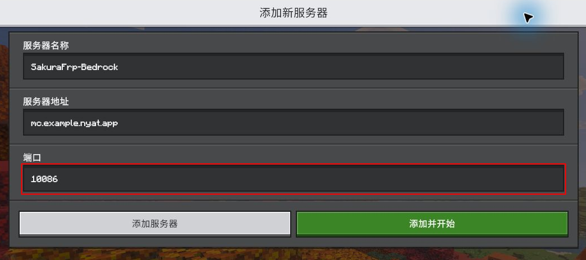

# 我的世界 (Minecraft) 基岩版服务器穿透指南 (NetherNet)

当您使用 `26.50` 及以上版本的基岩版服务端和游戏，您可能正被迫或默认使用 NetherNet（新联机协议）联机。

以下内容假设您在使用 `26.60` (即 `1.26.60`) 及以上版本的基岩版服务端，如使用更早的版本配置可能无效。

如果您希望使用仍支持 RakNet（旧联机协议）的旧版服务端和游戏，请参阅 [旧版基岩版开服指南](/offtopic/mc-bedrock-server.md)。

## 准备服务端 {#prepare-server}

选择一套服务端下载安装即可。请使用 1.26.60 及以上版本。

:::: tabs

@tab 官方 Bedrock Dedicated Server

1. 从 [Minecraft 官方网站](https://www.minecraft.net/zh-hans/download/server/bedrock) 下载 Windows 版 或 Linux 版。
1. 解压形如 `bedrock-server-版本号.zip` 的压缩包。
1. 打开同一文件夹中的 `server.properties` 准备编辑

@tab Endstone（插件服）

1. 从 [Endstone 发布页面](https://github.com/EndstoneMC/endstone/releases)下载名称以 `系统（如windows）-x86_64.zip` 结尾的独立包，完整解压到新文件夹
1. 双击 `start.cmd`，等待 插件工具 下载和初始化完成，控制台出现 `Would you like to download it now? [Y/n]:` 时，输入 `Y` 并回车确认下载。
1. 完成下载后您将看到 `Server started.`，在控制台输入 `stop` 回车，等待服务器退出
1. 打开 `bedrock_server` 文件夹中的 `server.properties` 准备编辑

请注意此服务端要求您总是使用 `start.cmd` 启动，不要自己尝试进入 `bedrock_server` 目录运行 exe，否则插件将失效。

@tab LeviLamina（插件服）

1. 按 [官方安装说明](https://lamina.levimc.org/zh/user_guides/install/) 安装 lip、所需运行库以及服务端
1. 服务端安装完成后，运行 `bedrock_server_mod.exe`，等待控制台出现 `Server started.`
1. 在控制台输入 `stop`，等待服务器退出，再打开同一文件夹中的 `server.properties`

::::

## 创建隧道 {#create-tunnels}

在服务器电脑上 [安装并登录 SakuraFrp 启动器](/launcher/usage.md)，点击启动器的加号 或在 [网站隧道列表页](https://www.natfrp.com/tunnel/) 开始创建隧道。

节点请选择支持 UDP 和 **未标记 `不可用于 MCBE`** 的 节点，我们更推荐名字里面带 **多线**（**不是** 三线）的节点。  
因为 MCBE 游戏协议实现的兼容性问题，若您使用 **三线节点**，其他运营商的玩家连接时可能体验会受到影响。

开始创建一条 TCP 隧道，并跟随下面配置：

- 隧道名称：任意，如 `MCBE`
- 隧道类型：`TCP`
- 本地 IP：服务端与启动器在同一台电脑时填写 `127.0.0.1`
- 远程端口：留空
- **本地端口：`19132`**，如果在后面的服务端配置中修改了 `server-port`，这里也要对应修改
- 自动 HTTPS：启用
- 自动 HTTPS 工作模式：点击 `高级` 即可看到此选项，选择 **反代至 HTTP**
- 批量创建选项：选中创建 同远程端口 UDP 隧道

点击创建后，您将会得到两个隧道，分别是 `设置名称_TCP` 和 `设置名称_UDP`，下面将其称为 `MCBE_TCP` 和 `MCBE_UDP`，如您指定了自己的名字，请自行脑内映射。

按 [子域绑定说明](/bestpractice/domain-bind.md#cname-for-site)，为 `MCBE_TCP` 创建 **CNAME** 绑定，**不要选 Minecraft Java 使用的 SRV 绑定**。

尝试启动或重启隧道，打开“日志”，确认已加载绑定域名的证书。下面是一段示例日志：

```log
2077/08/25 09:29:49 I Tunnel/MCBE_TCP [233/10/xxxx] 连接节点成功, 运行 ID [10-xxxx]
2077/08/25 09:29:49 I Tunnel/MCBE_TCP [233/10/xxxx] 已从服务器为 mc.example.nyat.app 加载证书 [CN = *.example.nyat.app, 2077-08-25 - 2077-11-23]
Tunnel/MCBE_TCP TCP 隧道启动成功
Tunnel/MCBE_TCP 使用 >>mc.example.nyat.app:10086<< 连接你的隧道
Tunnel/MCBE_TCP 或使用 IP 地址连接: >>114.5.1.4<<
```

看到 `已从服务器为 ... 加载证书` 后，记下连接地址中的 **连接域名 `mc.example.nyat.app`** 和 **远程端口 `10086`**，  
如果存在 **连接 IP `114.5.1.4`**，也请记下该 IP。

这些是示例值，连接时请以您自己的日志为准。

## 修改配置文件 {#advertise-address}

完成前序步骤操作后，您现在应当拥有：

- 连接域名（`mc.example.nyat.app`）
- 远程端口（`10086`）
- 本地端口（`19132`）
- 一个打开的 `server.properties` 文件
- 可能还拥有连接 IP（`114.5.1.4`）

::: details 如果您没有得到连接 IP，如何获取之

如果您没有得到连接 IP，说明您正在使用一个 **三线/双线节点**，MCBE 对此类节点兼容性不佳，在网络不好的时候可能卡顿。

但如果您无论如何希望用这个节点，可以跟随下面的方法获得 IP：

:::: tabs
@tab Windows
找到键盘上的 `徽标键`（通常是带有 Windows 徽标的键），或称 `Win 键`，下面所述 `Win` 即指该键。

按下 `Win + R` 打开运行窗口，输入 `cmd` 并回车，即可打开命令提示符。

在命令提示符中输入：

```cmd
nslookup 连接域名
```

并回车（Enter 键）执行。

如对于 `mc.example.nyat.app`，运行：

```cmd
nslookup mc.example.nyat.app
```

结果将类似

```cmd
服务器:  public1.alidns.com
Address:  223.5.5.5

非权威应答:
名称:    mc.example.nyat.app
Addresses:  114.5.1.4
```

最下面的 `114.5.1.4` 即为节点公网 IPv4。

@tab Linux
自己打开终端，ping 或者 nslookup 或者 dig 之，谢谢。
::::

在 `server.properties` 中找到并修改以下项目：  
（搜索等号前的部分，并修改等号后的数值）

```properties
transport=nethernet
server-port=本地端口
server-udp-ports=连接 IP:远程端口:本地端口
```

- `transport`：传输协议，保持默认 `nethernet` 即可，如果您希望使用 RakNet，请参考  [旧版基岩版开服指南](/offtopic/mc-bedrock-server.md)
- `server-port`：服务器的 **本地端口**，数值应当等于您已拥有的本地端口配置项，默认是 19132
- `server-udp-ports`：填写格式为 `连接 IP:远程端口:本地端口`，确保与您已拥有的连接信息一致，最终结果类似 `114.5.1.4:10086:19132`

::: details 您可能还希望修改

```properties
allow-list=false
```

- `allow-list=false`：关闭白名单，朋友拿到连接地址后就能加入，不必逐个添加名字

如果未修改 `allow-list`，您将遇到 `您未获准加入此服务器` 错误，  
需要启动后在控制台输入 `allowlist add "玩家昵称"` 添加您自己和朋友，或者直接设置为 `allow-list=false`。

:::

修改完成后，确认服务器已启动，两条隧道也都处于开启状态，然后即可加入。

请确保 **两条隧道** 都应启动。

## 加入服务器 {#join-server}

打开 Minecraft 基岩版，在 `服务器` 页面点击 `添加服务器`。填写：

- 服务器名称：自行命名，例如 `SakuraFrp-Bedrock`
- 服务器地址：前述连接域名，如 `mc.example.nyat.app`
- 端口：前述远程端口，如 `10086`



点击 **添加并开始** 即可加入。

## 常见问题 {#common-issues}

请确认玩家填写的是正确的 连接域名 和 远程端口，对应上面教程位置即为 `mc.example.nyat.app` 和 `10086`。

请注意 **所有两个** 隧道都应启动。

请确认启动器日志已加载可信证书，  
日志内容应形如 `已从服务器为 mc.example.nyat.app 加载证书`，  
而不是 `当前证书由 frpc 自动生成`。

请确认已将 `自动 HTTPS 工作模式` （在 自动 HTTPS 设置后面的 **高级** 菜单中）设为 **反代至 HTTP**。

使用自己的域名时需自行配置证书，参阅 [配置 frpc 使用的 SSL 证书](/frpc/ssl.md)。

如遇 `您未获准加入此服务器`，请使用 控制台命令 `allowlist add "玩家昵称"` 添加您自己和朋友，  
或者在 `server.properties` 中将 `allow-list` 设置为 `false` 关闭白名单功能。
